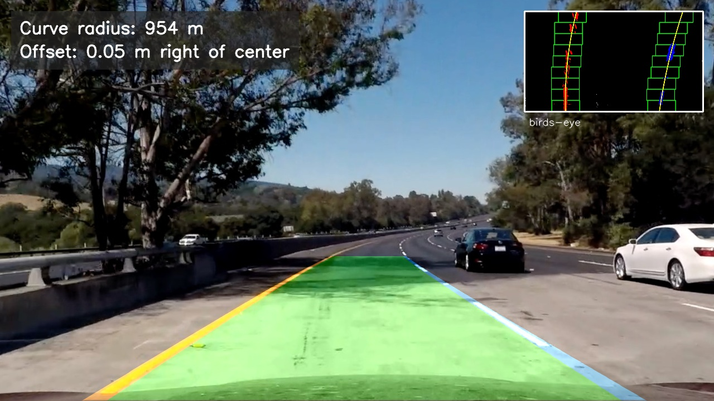
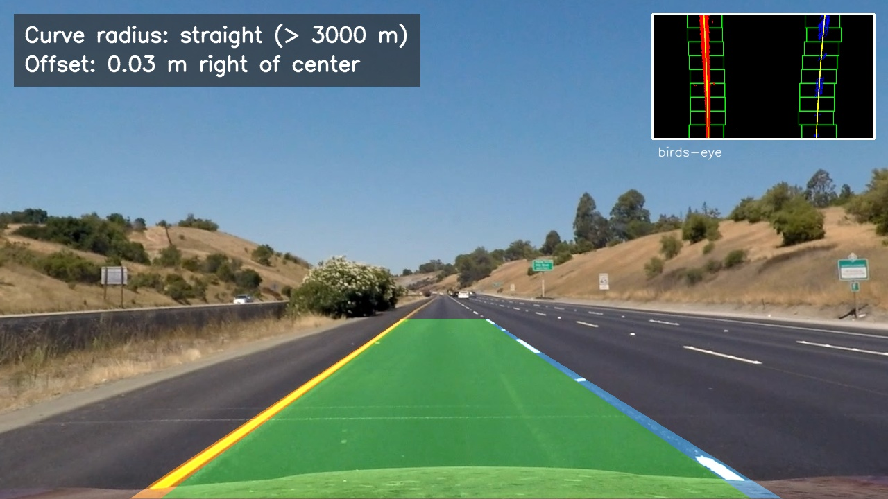
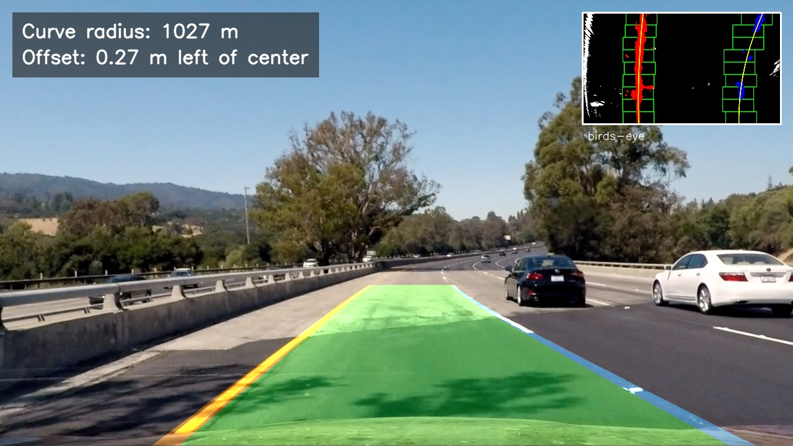

## Writeup Template

### You use this file as a template for your writeup.

---

**Lane Finding Project**

The goals / steps of this project are the following:

* Compute the camera calibration matrix and distortion coefficients given a set of chessboard images.
* Apply a distortion correction to raw images.
* Use color transforms, gradients, etc., to create a thresholded binary image.
* Apply a perspective transform to rectify binary image ("birds-eye view").
* Detect lane pixels and fit to find the lane boundary.
* Determine the curvature of the lane and vehicle position with respect to center.
* Warp the detected lane boundaries back onto the original image.
* Output visual display of the lane boundaries and numerical estimation of lane curvature and vehicle position.

[//]: # (Image References)

[image1]: ./examples/undistort_output.png "Undistorted"
[image2]: ./test_images/test1.jpg "Road Transformed"
[image3]: ./examples/binary_combo_example.jpg "Binary Example"
[image4]: ./examples/warped_straight_lines.jpg "Warp Example"
[image5]: ./examples/color_fit_lines.jpg "Fit Visual"
[image6]: ./examples/example_output.jpg "Output"
[video1]: ./project_video.mp4 "Video"

---

### Writeup / README

#### 1. Provide a Writeup that includes all the rubric points and how you addressed each one.

You're reading it!

### Camera Calibration

#### 1. Briefly state how you computed the camera matrix and distortion coefficients. Provide an example of a distortion corrected calibration image.

The calibration images in `camera_cal/` show a chessboard with 9×6 inner corners photographed from 20 different angles and distances.
1. Object points (`find_corners()`): For every image I prepare the same grid of 3D points (0,0,0), (1,0,0), …, (8,5,0). These are the real positions of the corners on a flat board, so z = 0 and the board is assumed to be fixed in space.
2. Image points (`find_corners()`): Each image is converted to grayscale and passed to `cv2.findChessboardCorners()`. When all 54 corners are found, their positions are refined to sub-pixel accuracy with `cv2.cornerSubPix()`. The object/image point pair for that image is then stored.
* Corners were found in 17 of 20 images.
* `calibration1.jpg`, `calibration4.jpg` and `calibration5.jpg` were skipped because part of the board lies outside the frame.

3. Calibration (`calibrate()`): All point pairs are passed to `cv2.calibrateCamera()`. This estimates the camera matrix and the distortion coefficients that best map the ideal grid onto the observed corners.

| Result | Value |
|---|---|
| Image size | 1280 × 720 px |
| Focal length `fx`, `fy` | 	1156.46, 1151.27 px |
| Optical center `cx`, `cy` | 671.32, 389.22 px |
| Distortion `k1`, `k2`, `p1`, `p2`, `k3` | -0.2467, -0.0254, -0.0007, 0.0001, 0.0107 |
| RMS reprojection error | 1.00 px |

The large negative `k1` indicates strong barrel distortion: straight lines bow outward toward the image edges. The tangential terms `p1`, `p2` are close to zero, so the sensor is well aligned with the lens.

The result is saved to `camera_cal/calibration.json` and later loaded with `load_calibration()`, so calibration runs only once.

Applying `cv2.undistort()` (`undistort()`) to `calibration1.jpg` straightens the curved edges of the board. This image was not used for calibration, so it also serves as an independent check:

### Pipeline (single images)
#### 1. Provide an example of a distortion-corrected image.

The first step of the pipeline undistorts every frame with the stored calibration (`undistort()` in `src/calibration.py`). On a road image the effect is most visible near the image borders. The car hood at the bottom and the white car on the right change shape and position, because the image is "pulled in" at the edges:

Without this step, lane lines that are straight in the world would appear curved. That would bias the lane curvature measured later.

#### 2. Describe how (and identify where in your code) you used color transforms, gradients or other methods to create a thresholded binary image.  Provide an example of a binary image result.

The thresholding went through two versions. Version 1 worked on all test images but failed on the challenge videos, so the pipeline now uses version 2. Both are kept in the code (`threshold_v1()` and `threshold()`) so they can be compared.

The undistorted image is converted to the HLS color space. Lane colors are easier to separate there than in RGB: the S (saturation) channel stays strong under shadows, and the L (lightness) channel isolates white well. Then three binary masks are combined with a logical OR: Gradient(Sobel x) - `sobel_x_binary()` - for near-vertical edges such as lane line borders, Saturation - `channel_binary()` for strongly colored lines, also in shadow and Yellow/White - `yellow_white_binary()` for the actual paint colors of lane lines.

The Sobel operator in the x direction responds to changes in brightness from left to right. Lane lines seen from the car are close to vertical, so this direction suppresses most horizontal edges, such as shadows across the road. The color masks complement the gradient in places where the contrast is low but the color is still recognizable. An example is the yellow line on the light concrete in `test5.jpg`, which is detected almost only by the color mask (blue).

While tuning version 1, I wrote `src/debug_masks.py`, which shows every mask separately in the birds-eye view. It showed that the light beige concrete of the bridge in `test1.jpg` and `test4.jpg` has a hue in the yellow range and a moderate saturation (S ≈ 80–120). The yellow mask therefore accepted it as yellow paint, until the lower bound was raised to S ≥ 130.

On the challenge videos, version 1 had two problems that could not be fixed by tuning thresholds:

-The Sobel gradient responds to every edge, not only to lane lines. In `challenge02.mp4` this includes the edge of the concrete barrier, the border between dark asphalt and light concrete, and dark tar seams on the road. After warping these look like lane lines, and the left line was often fitted to the barrier.
-The yellow line in `challenge02.mp4` is pale (S ≈ 80–95), so the HLS yellow mask (S ≥ 130) misses it. Lowering the bound would bring back the beige concrete from `test1.jpg`. The two cases cannot be separated by HLS saturation.

Version 2: bright stripe + LAB yellow (`threshold()`):

`stripe_binary()` for narrow structures brighter than their surroundings: painted lines.
`yellow_lab_binary()` for yellow paint.

The top-hat transform is the image minus its morphological opening. An opening with a horizontal 31 px kernel removes every bright structure narrower than 31 px, so the difference keeps only those narrow bright structures. A painted line is narrow and brighter than the road, so it passes. A barrier edge, an asphalt/concrete border or a dark seam is not a narrow bright stripe, so it does not pass.

The b channel of the LAB color space measures the blue–yellow axis (128 is neutral). Yellow paint has b ≥ 150 even when it is pale: about 157 in challenge02.mp4. The beige concrete stays below about 140. So one threshold works for both cases where the HLS yellow mask needed contradicting thresholds.

Comparison in the birds-eye view, with version 1 in the middle and version 2 on the right. In `challenge02.mp4`, version 1 loses the pale yellow line and detects the barrier edge and seams. Version 2 detects only the yellow line and the dashed right line:

On the project video, version 2 is at least as good as version 1 and removes the barrier edge on the far left:

Version 2 on the test images. Green pixels come from the bright stripe mask, blue pixels from the yellow mask, and the right panel is the final binary image:

Both lane lines are detected clearly on all test images, including the yellow line on light concrete and the dashed right line. The binary image also contains noise from trees, cars, bright sky and roadside vegetation. All binary results are saved in `output_images/binary/`.

#### 3. Describe how (and identify where in your code) you performed a perspective transform and provide an example of a transformed image.

In the camera image, parallel lane lines converge toward the horizon. To measure lane curvature and width, the image is transformed into a top-down ("birds-eye") view in which the lane lines are parallel again.

I picked four source points on `straight_lines1.jpg` that lie on the lane lines and form a rectangle on the road, which appears as a trapezoid in the image. They are mapped to four destination points forming an upright rectangle.

`cv2.getPerspectiveTransform()` computes the 3×3 transformation matrix `M` from these point pairs, and its inverse `Minv` from the swapped pairs. The constants `M` and `MINV` are computed once when the module is loaded. The function `warp()` applies `M` with `cv2.warpPerspective()`, and `unwarp()` applies `Minv`. `unwarp()` is used at the end of the pipeline to draw the detected lane back onto the camera image.

I verified the transform by drawing the source points on a straight road image and the destination points on its warped counterpart. Both lane lines are vertical and parallel after warping, and they lie on the destination rectangle:

Applied to the binary image, the transform also removes most of the noise above the horizon and beside the road:

The 960×540 test images taken with a different camera (`challange*`, `solid*`, `whiteCarLaneSwitch`) are skipped, because both the calibration and the source points are valid only for the 1280×720 camera. Warped binaries of all other test images are saved in `output_images/warped_binary/`.
#### 4. Describe how (and identify where in your code) you identified lane-line pixels and fit their positions with a polynomial?

The input is the warped binary image from step 3. Lane pixels are found in three stages:
1. Histogram (`lane_histogram()`, `find_base_positions()`): the white pixels in the bottom half of the image are summed per column. Lane lines are close to vertical in the birds-eye view, so they produce two clear peaks. The strongest peak left of the image center is the starting position of the left line, and the strongest peak right of the center is the start of the right line. Columns with x < 100 and x > 1180 are ignored (gray areas in the figure below). This excludes the edge of the concrete barrier, which appears as a thin line at the far left of several warped images.
2. Sliding windows (`sliding_window()`): starting from the two peaks, 9 windows per line are stacked from the bottom to the top of the image. Each window is 200 px wide (`MARGIN = 100`). All white pixels inside a window are assigned to that line. If a window contains more than 50 pixels (`MINPIX`), the next window is centered on their mean x position, so the windows follow the line when it curves. For dashed lines, empty windows simply keep the previous x position.
3. Polynomial fit (`fit_line()`): a second-order polynomial is fitted through the pixels of each line with `np.polyfit()`: `x = A·y² + B·y + C` x is fitted as a function of y, not the other way around, because the lines are nearly vertical: one x value can correspond to many y values. A line is considered not found if fewer than 300 pixels are assigned to it.

In the figure below, the green rectangles are the windows, red and blue pixels are assigned to the left and right line, and the yellow curves are the fitted polynomials:

Both lines were found on all 8 test images from the 1280×720 camera. The coefficient A describes the curvature. On the straight road images it is close to zero, and on the curved road images both lines bend in the same direction (same sign of A). The right line always has fewer pixels because it is dashed, so its fit is less certain. On `test4.jpg`, for example, its curvature is about 3.5 times larger than that of the left line, which is influenced by a single dash near the top of the image:

For video, `search_around_poly()` searches only within ±100 px around the polynomial from the previous frame instead of starting the window search from scratch. `find_lane()` selects the method automatically and falls back to sliding windows if the search around the previous polynomial finds too few pixels.
#### 5. Describe how (and identify where in your code) you calculated the radius of curvature of the lane and the position of the vehicle with respect to center.

Pixels to meters. The polynomials from step 4 are in pixels of the birds-eye image. They are converted to meters using known dimensions of a US highway. The y factor is consistent with the dashed lane markings: one dash plus one gap is 12 m (3 m + 9 m), which is about 300 px in the warped images.

Radius of curvature (`poly_to_meters()`, `radius_of_curvature()`): the coefficients of `x = A·y² + B·y + C` are scaled to meters:

`A_m = A · XM_PER_PIX / YM_PER_PIX², B_m = B · XM_PER_PIX / YM_PER_PIX`

The radius is then computed with

`R = (1 + (2·A_m·y + B_m)²)^(3/2) / |2·A_m|`

at the bottom of the image (`y = 719`), which is the point directly in front of the vehicle. The lane radius is the mean of the left and right line radius.

Vehicle position: the camera is mounted in the middle of the vehicle, so the vehicle center is the image center (`x = 640`). The lane center is the midpoint between the two lines at the bottom of the image:

`offset = (vehicle center − lane center) · XM_PER_PIX`

A positive offset means the vehicle is right of the lane center, a negative offset means it is left of center. `lane_metrics()` also returns the lane width and the distance from the vehicle center to each line. The distances are used later for the lane departure warning.

#### 6. Provide an example image of your result plotted back down onto the road such that the lane area is identified clearly.

`process_image()` runs the complete single-image pipeline:

`undistort → threshold → warp → find_lane → lane_metrics → draw`

The drawing (`draw_lane()`) works in the birds-eye view first:

1. The area between the two polynomials is filled in green with `cv2.fillPoly()`. The left line is drawn in orange and the right line in blue.
2. The drawing is warped back into the camera perspective with the inverse matrix `Minv` (`unwarp()` from step 3).
3. It is blended semi-transparently over the undistorted image with `cv2.addWeighted()`.

Two additions make the result easier to read and debug:

Info panel (`draw_panel()`, top left): the lane radius and the vehicle offset from step 5. A radius above 3000 m is shown as "straight".
Birds-eye inset (`draw_inset()`, top right): a small copy of the warped binary image with the sliding windows, the detected pixels and the fitted polynomials. It shows directly which pixels the lane estimate is based on.

On a straight road and on a curved road with shadows and a change of the road surface:

The detected lane matches the real lane on all 8 test images:

### Pipeline (video)

#### 1. Provide a link to your final video output.  Your pipeline should perform reasonably well on the entire project video (wobbly lines are ok but no catastrophic failures that would cause the car to drive off the road!).

For every video it writes the processed video `output_videos/<name>.mp4` and a log `output_videos/<name>_log.csv`. The log has one row per frame with the detection status, pixel counts, lane radius, vehicle offset, lane width and the distance to each line. The processed videos are not stored in the repository because of their size.

**Processed videos:** [all videos (Lane-Finding-lane-videos)](https://drive.google.com/drive/folders/1lp-PvbL_NSN0Of0ycQIBD7DDEAv_wR-S?usp=sharing)

| Video | Camera | Result |
|---|---|---|
| [project_video01](https://drive.google.com/file/d/12Z-wNRooDzyq8Cuh91TgxxAXBAVowsn4/view?usp=sharing) | B | lane detected over the whole video |
| [project_video02](https://drive.google.com/file/d/1lH3cNyggisdu5wsS4kN4F8habHGDYJf0/view?usp=sharing) | B | lane detected over the whole video |
| [project_video03](https://drive.google.com/file/d/1UHujuS9VVqR0VC0mBnMqpt4g7hHkdKND/view?usp=sharing) | A | lane detected over the whole video |
| [challenge01](https://drive.google.com/file/d/1aOQ1gkSVwGuxWYJ3_k7PBYoCJ2iIpWvD/view?usp=sharing) | A | lane detected over the whole video |
| [challenge02](https://drive.google.com/file/d/1eEq4U6gBzKwPUJsZPi7xRqNEpjIBVLxy/view?usp=sharing) | A, own source points | lane detected, last lane held under the overpass |
| [challenge03](https://drive.google.com/file/d/1PsaI0J3HNRmMxAbX2x2UcNWsJRPCF0yq/view?usp=sharing) | A | partial, see Discussion | 

Every frame goes through the single-image pipeline from steps 1–6. The video pipeline adds the following on top (`LaneTracker`):
1. Tracking: after a successful frame, the lines in the next frame are searched only within ±100 px of the previous polynomials (`search_around_poly()`). This is faster and ignores most of the noise further away.
2. Sanity check (`sanity_check()`): a frame is accepted only if
both lines were found,
the lane width at the bottom of the image is 2.8–4.5 m,
the lines are roughly parallel: the lane width at the top and at the bottom of the birds-eye image differ by less than 1.0 m.
3. Smoothing: the drawn lane is the mean of the polynomials from the last 8 accepted frames, so it does not jump from frame to frame.
4. Weak line rescue (`rescue_weak_line()`): if the check fails, the line with more pixels is trusted, but only if its position at the bottom of the image is within 0.5 m of the previous frame. The other line, usually the dashed one, is replaced by a copy of it, shifted by the lane width from the history.
5. Recovery: if the check still fails, the last accepted lane is drawn. After 5 failed frames in a row the line search restarts with sliding windows. After 25 failed frames (about 1 s) the history is cleared and "Lane not detected" is shown.

The info panel shows the current status ("ok", "right line from left", "re-search", …), so the behavior of the tracker can be followed directly in the video.

The videos come from two different cameras: A(1280x720) which are `project_video03, challenge01–03`, B(960x540) which are `project_video01–02`. For camera A it is same camera as the test images: calibration and source points from steps 1 and 3, but for camera B is different camera without chessboard images: the frame is resized to 1280×720, undistortion is skipped, and separate source points are used (`SRC_B`).
The source points for camera B were chosen on the first frame of `project_video01`, where the road is straight. They were checked the same way as in step 3. 

In `challenge02.mp4` the lane lines converged toward the top of the birds-eye image. The log showed a width difference of about 1 m between the top and the bottom in almost every frame, so the sanity check failed in most frames. The video comes from camera A, but the horizon is about 15 px lower than in the test images, because the camera was mounted with a slightly different tilt or the road has a different slope. Near the top of the source trapezoid, 15 px already makes a difference of about 1 m in the birds-eye view.

The source points for this video are therefore estimated automatically on a frame with a straight road (`fit_src()`):
1. The binary image is limited to a trapezoid in front of the car.
2. `cv2.HoughLinesP()` finds line segments. Segments with a negative slope belong to the left line and segments with a positive slope to the right line. A straight line x = a·y + b is fitted through each group.
3. The intersection of the two lines is the vanishing point (horizon at y = 438 instead of about 425 for the test images).
4. The source points are where the two lines cross the bottom of the image and the row 38 px below the horizon.

The result:

After this change, the median width difference between the top and the bottom in `challenge02.mp4` fell from about 1.0 m to 0.18 m.

On the three project videos and on `challenge01` and `challenge02` the lane is detected correctly over the whole video. The rejected frames in `challenge02` are the dark section under the overpass, where the last accepted lane is drawn. `challenge03` (a narrow mountain road with very sharp curves) is detected only partially: more than half of the frames need a rescued line, and the drawn lane often deviates from the real one. The reasons are discussed below.
### Discussion

#### 1. Briefly discuss any problems / issues you faced in your implementation of this project.  Where will your pipeline likely fail?  What could you do to make it more robust?

TODO: Add your text here!!!

