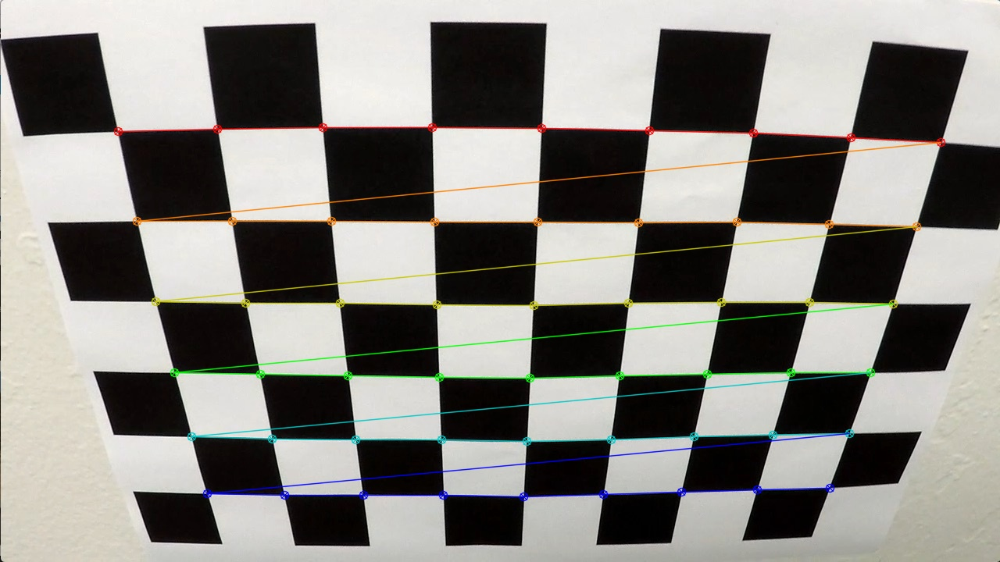
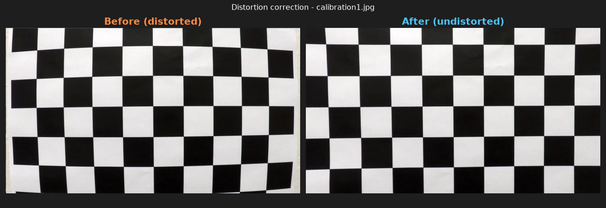
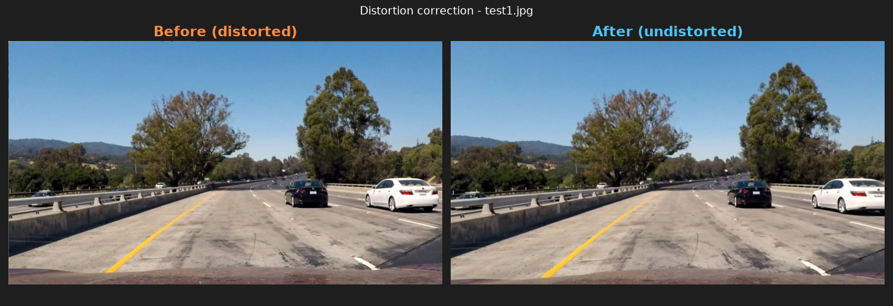
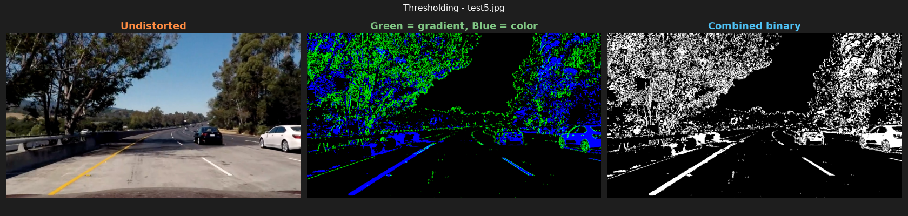
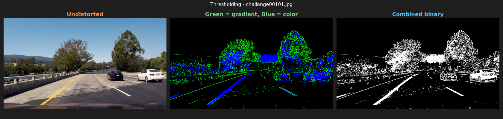
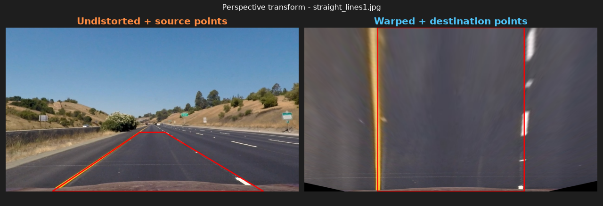
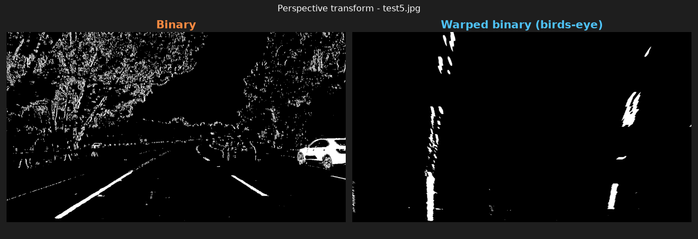
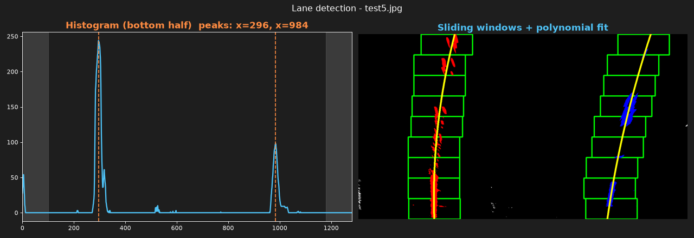
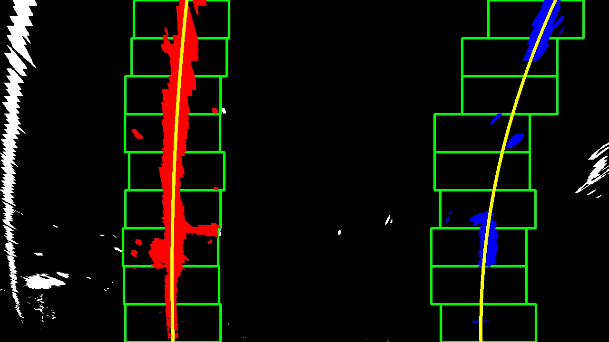

## Writeup Template

### You use this file as a template for your writeup.

---

**Lane Finding Project**

The goals / steps of this project are the following:

* Compute the camera calibration matrix and distortion coefficients given a set of chessboard images.
* Apply a distortion correction to raw images.
* Use color transforms, gradients, etc., to create a thresholded binary image.
* Apply a perspective transform to rectify binary image ("birds-eye view").
* Detect lane pixels and fit to find the lane boundary.
* Determine the curvature of the lane and vehicle position with respect to center.
* Warp the detected lane boundaries back onto the original image.
* Output visual display of the lane boundaries and numerical estimation of lane curvature and vehicle position.

[//]: # (Image References)

[image1]: ./examples/undistort_output.png "Undistorted"
[image2]: ./test_images/test1.jpg "Road Transformed"
[image3]: ./examples/binary_combo_example.jpg "Binary Example"
[image4]: ./examples/warped_straight_lines.jpg "Warp Example"
[image5]: ./examples/color_fit_lines.jpg "Fit Visual"
[image6]: ./examples/example_output.jpg "Output"
[video1]: ./project_video.mp4 "Video"

---

### Writeup / README

#### 1. Provide a Writeup that includes all the rubric points and how you addressed each one.

You're reading it!

### Camera Calibration

#### 1. Briefly state how you computed the camera matrix and distortion coefficients. Provide an example of a distortion corrected calibration image.

The calibration images in `camera_cal/` show a chessboard with 9×6 inner corners photographed from 20 different angles and distances.
1. Object points (`find_corners()`): For every image I prepare the same grid of 3D points (0,0,0), (1,0,0), …, (8,5,0). These are the real positions of the corners on a flat board, so z = 0 and the board is assumed to be fixed in space.
2. Image points (`find_corners()`): Each image is converted to grayscale and passed to `cv2.findChessboardCorners()`. When all 54 corners are found, their positions are refined to sub-pixel accuracy with `cv2.cornerSubPix()`. The object/image point pair for that image is then stored.
* Corners were found in 17 of 20 images.
* `calibration1.jpg`, `calibration4.jpg` and `calibration5.jpg` were skipped because part of the board lies outside the frame.

3. Calibration (`calibrate()`): All point pairs are passed to `cv2.calibrateCamera()`. This estimates the camera matrix and the distortion coefficients that best map the ideal grid onto the observed corners.

| Result | Value |
|---|---|
| Image size | 1280 × 720 px |
| Focal length `fx`, `fy` | 	1156.46, 1151.27 px |
| Optical center `cx`, `cy` | 671.32, 389.22 px |
| Distortion `k1`, `k2`, `p1`, `p2`, `k3` | -0.2467, -0.0254, -0.0007, 0.0001, 0.0107 |
| RMS reprojection error | 1.00 px |

The large negative `k1` indicates strong barrel distortion: straight lines bow outward toward the image edges. The tangential terms `p1`, `p2` are close to zero, so the sensor is well aligned with the lens.

The result is saved to `camera_cal/calibration.json` and later loaded with `load_calibration()`, so calibration runs only once.

Applying `cv2.undistort()` (`undistort()`) to `calibration1.jpg` straightens the curved edges of the board. This image was not used for calibration, so it also serves as an independent check:

### Pipeline (single images)
#### 1. Provide an example of a distortion-corrected image.

The first step of the pipeline undistorts every frame with the stored calibration (`undistort()` in `src/calibration.py`). On a road image the effect is most visible near the image borders. The car hood at the bottom and the white car on the right change shape and position, because the image is "pulled in" at the edges:

Without this step, lane lines that are straight in the world would appear curved. That would bias the lane curvature measured later.

#### 2. Describe how (and identify where in your code) you used color transforms, gradients or other methods to create a thresholded binary image.  Provide an example of a binary image result.

The undistorted image is converted to the HLS color space. Lane colors are easier to separate there than in RGB: the S (saturation) channel stays strong under shadows, and the L (lightness) channel isolates white well. Then three binary masks are combined with a logical OR: Gradient(Sobel x) - `sobel_x_binary()` - for near-vertical edges such as lane line borders, Saturation - `channel_binary()` for strongly colored lines, also in shadow and Yellow/White - `yellow_white_binary()` for the actual paint colors of lane lines.

The Sobel operator in the x direction responds to changes in brightness from left to right. Lane lines seen from the car are close to vertical, so this direction suppresses most horizontal edges, such as shadows across the road. The color masks complement the gradient in places where the contrast is low but the color is still recognizable. An example is the yellow line on the light concrete in `test5.jpg`, which is detected almost only by the color mask (blue).

In the middle panel below, green pixels come from the gradient and blue pixels from the color masks. The right panel is the final binary image:

Both lane lines are detected clearly on all test images, including the yellow line on light concrete and the dashed right line. The binary image also contains noise from trees, cars, bright sky and roadside vegetation. All binary results are saved in `output_images/binary/`.

#### 3. Describe how (and identify where in your code) you performed a perspective transform and provide an example of a transformed image.

In the camera image, parallel lane lines converge toward the horizon. To measure lane curvature and width, the image is transformed into a top-down ("birds-eye") view in which the lane lines are parallel again.

I picked four source points on `straight_lines1.jpg` that lie on the lane lines and form a rectangle on the road, which appears as a trapezoid in the image. They are mapped to four destination points forming an upright rectangle.

`cv2.getPerspectiveTransform()` computes the 3×3 transformation matrix `M` from these point pairs, and its inverse `Minv` from the swapped pairs. The constants `M` and `MINV` are computed once when the module is loaded. The function `warp()` applies `M` with `cv2.warpPerspective()`, and `unwarp()` applies `Minv`. `unwarp()` is used at the end of the pipeline to draw the detected lane back onto the camera image.

I verified the transform by drawing the source points on a straight road image and the destination points on its warped counterpart. Both lane lines are vertical and parallel after warping, and they lie on the destination rectangle:

Applied to the binary image, the transform also removes most of the noise above the horizon and beside the road:

The 960×540 test images taken with a different camera (`challange*`, `solid*`, `whiteCarLaneSwitch`) are skipped, because both the calibration and the source points are valid only for the 1280×720 camera. Warped binaries of all other test images are saved in `output_images/warped_binary/`.
#### 4. Describe how (and identify where in your code) you identified lane-line pixels and fit their positions with a polynomial?

The input is the warped binary image from step 3. Lane pixels are found in three stages:
1. Histogram (`lane_histogram()`, `find_base_positions()`): the white pixels in the bottom half of the image are summed per column. Lane lines are close to vertical in the birds-eye view, so they produce two clear peaks. The strongest peak left of the image center is the starting position of the left line, and the strongest peak right of the center is the start of the right line. Columns with x < 100 and x > 1180 are ignored (gray areas in the figure below). This excludes the edge of the concrete barrier, which appears as a thin line at the far left of several warped images.
2. Sliding windows (`sliding_window()`): starting from the two peaks, 9 windows per line are stacked from the bottom to the top of the image. Each window is 200 px wide (`MARGIN = 100`). All white pixels inside a window are assigned to that line. If a window contains more than 50 pixels (`MINPIX`), the next window is centered on their mean x position, so the windows follow the line when it curves. For dashed lines, empty windows simply keep the previous x position.
3. Polynomial fit (`fit_line()`): a second-order polynomial is fitted through the pixels of each line with `np.polyfit()`: `x = A·y² + B·y + C` x is fitted as a function of y, not the other way around, because the lines are nearly vertical: one x value can correspond to many y values. A line is considered not found if fewer than 300 pixels are assigned to it.

In the figure below, the green rectangles are the windows, red and blue pixels are assigned to the left and right line, and the yellow curves are the fitted polynomials:

Both lines were found on all 8 test images from the 1280×720 camera. The coefficient A describes the curvature. On the straight road images it is close to zero, and on the curved road images both lines bend in the same direction (same sign of A). The right line always has fewer pixels because it is dashed, so its fit is less certain. On `test4.jpg`, for example, its curvature is about 3.5 times larger than that of the left line, which is influenced by a single dash near the top of the image:

For video, `search_around_poly()` searches only within ±100 px around the polynomial from the previous frame instead of starting the window search from scratch. `find_lane()` selects the method automatically and falls back to sliding windows if the search around the previous polynomial finds too few pixels.
#### 5. Describe how (and identify where in your code) you calculated the radius of curvature of the lane and the position of the vehicle with respect to center.

TODO: Add your text here!!!

#### 6. Provide an example image of your result plotted back down onto the road such that the lane area is identified clearly.

TODO: Add your text here!!!

### Pipeline (video)

#### 1. Provide a link to your final video output.  Your pipeline should perform reasonably well on the entire project video (wobbly lines are ok but no catastrophic failures that would cause the car to drive off the road!).

TODO: Add your text here!!!

### Discussion

#### 1. Briefly discuss any problems / issues you faced in your implementation of this project.  Where will your pipeline likely fail?  What could you do to make it more robust?

TODO: Add your text here!!!

